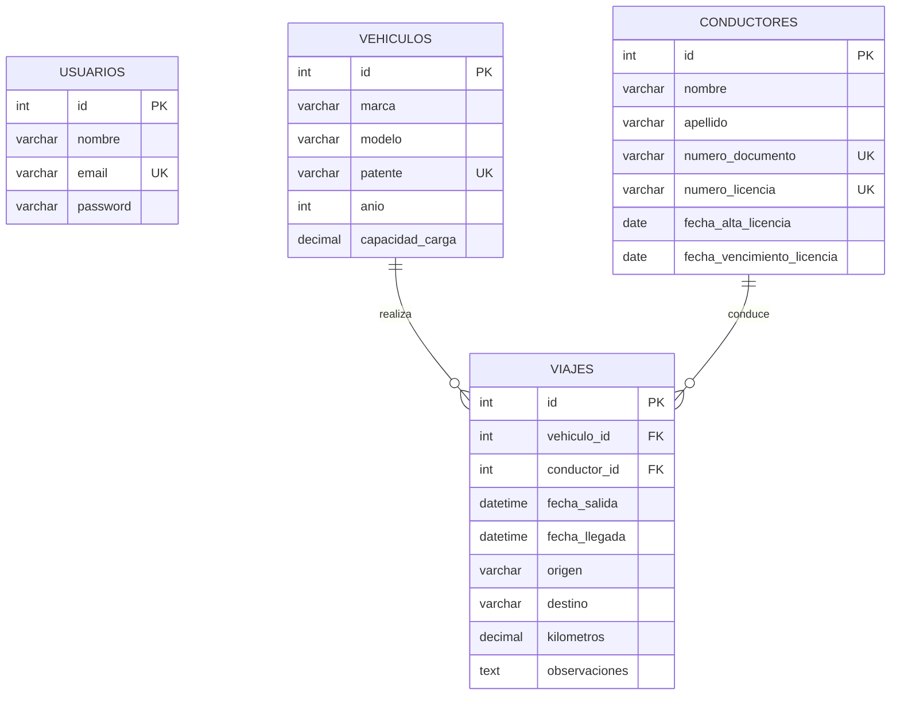

# Gestión de vehículos, conductores y viajes

Aplicación web para registrar los vehículos de una empresa de transporte, sus conductores y los viajes realizados. Trabajo Práctico N.º 3 – Programación IV (UTN FRLR).

## Tecnologías

- **Frontend:** Vite + React (JavaScript), React Router, CSS puro, `fetch`.
- **Backend:** Node.js + Express, MySQL (`mysql2`), `express-validator`.
- **Autenticación:** JWT (expira a las 4 horas) verificado con Passport (`passport-jwt`). Contraseñas encriptadas con `bcrypt`.

## Estructura

```
backend/
  database/schema.sql   Definición de las tablas
  http/                 Archivos .http para probar la API
  src/                  config, middlewares, routes y app.js
frontend/
  src/
    components/         Navbar, ProtectedRoute
    pages/              Home, Login, Vehiculos, Conductores, Viajes
    services/api.js     Capa de fetch con token JWT
```

## Instalación

### 1. Base de datos

Con MySQL en ejecución, ejecutar el script:

```
mysql -u root -p < backend/database/schema.sql
```

### 2. Backend

```
cd backend
npm install
```

Copiar `.env.example` a `.env` y completar los valores (datos de MySQL y secreto JWT). Luego:

```
npm run dev
```

La API queda en `http://localhost:3000/api`.

### 3. Frontend

```
cd frontend
npm install
```

Crear `frontend/.env` con:

```
VITE_API_URL=http://localhost:3000/api
```

Luego:

```
npm run dev
```

La aplicación queda en `http://localhost:5173`.

## Uso

1. Registrarse o iniciar sesión desde la página de login.
2. Gestionar vehículos y conductores (alta, modificación y baja).
3. Registrar viajes asociando un vehículo y un conductor.
4. Consultar el historial por vehículo o conductor y calcular los kilómetros totales.

## Pruebas de la API

Los archivos de `backend/http/` (`auth.http`, `vehiculos.http`, `conductores.http`, `viajes.http`) se ejecutan con la extensión REST Client de VS Code. Ejecutar siempre primero el **Login**.

Códigos probados: 200, 201, 204, 400, 401, 403 y 404. El 500 se prueba apagando MySQL y consultando un listado.

## Modelo de datos



## Decisiones de diseño

### Base de datos

- **Tabla `viajes` como tabla intermedia:** un vehículo puede hacer muchos viajes y un conductor también. Cada viaje une a un vehículo con un conductor, así se puede consultar el historial de cualquiera de los dos.
- **Datos únicos (`UNIQUE`):** email, patente, número de documento y número de licencia no se pueden repetir, porque identifican a una sola persona o vehículo.
- **Sin `ON DELETE CASCADE`:** si se borrara un vehículo o conductor, se borrarían sus viajes y se perdería el historial. Por eso la base rechaza el borrado y la API avisa "No se puede eliminar: tiene viajes asociados".
- **`DECIMAL` para kilómetros y capacidad de carga:** guarda valores exactos con decimales, sin errores de redondeo como los que tiene `FLOAT`.

### Seguridad

- **Contraseñas con bcrypt:** se guarda un hash y nunca la contraseña real. Aunque alguien vea la base de datos, no puede leerlas.
- **JWT con vencimiento de 4 horas:** tras iniciar sesión, el servidor entrega un token que el frontend envía en cada pedido. Si se vence, hay que volver a ingresar.
- **Rutas protegidas con Passport (`passport-jwt`):** vehículos, conductores y viajes solo responden si el token es válido. Sin token, la API devuelve 401.

### Reglas de negocio

- **Licencia vencida:** no se registra un viaje con un conductor cuya licencia esté vencida (error 403).
- **Fechas coherentes:** la llegada no puede ser anterior a la salida.
- **Validación doble:** los datos se validan en el frontend (para avisar rápido al usuario) y en el backend con `express-validator` (porque el frontend se puede saltear).